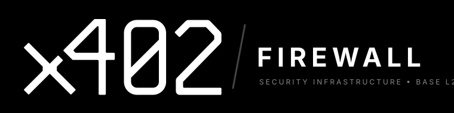

<p align="center">
  
</p>

# 🔥 x402Firewall

**Smart Wallet Firewall & Auto-Pay Wrapper for AI Agents on Base L2**

[](https://www.typescriptlang.org/)
[](https://base.org)
[](https://x402.org)
[](https://sqlite.org)
[]()

> Allow AI agents (Claude, Cursor, custom bots) to autonomously query and pay for `x402` (HTTP 402 Payment Required) APIs and execute EVM transactions on Base L2 with strict, deterministic spending caps, allowlists, and pre-execution transaction simulation.

---

## ⚡ 60-Second Quickstart (Claude Desktop & Cursor)

### 1. Claude Desktop Setup
Add `x402-firewall` to your `claude_desktop_config.json` (`~/Library/Application Support/Claude/claude_desktop_config.json` on macOS):

```json
{
  "mcpServers": {
    "x402-firewall": {
      "command": "npx",
      "args": ["-y", "x402-firewall"],
      "env": {
        "NETWORK": "base-sepolia",
        "PRIVATE_KEY": "0xYOUR_TESTNET_OR_MAINNET_PRIVATE_KEY",
        "MAX_PER_CALL_USDC": "0.05",
        "MAX_HOURLY_USDC": "1.00",
        "MAX_DAILY_USDC": "5.00",
        "BLOCK_UNLIMITED_APPROVALS": "true"
      }
    }
  }
}
```

### 2. Cursor / Antigravity IDE Setup
In your workspace root or `.cursor/mcp.json`:

```json
{
  "mcpServers": {
    "x402-firewall": {
      "command": "node",
      "args": ["/path/to/x402-firewall/dist/cli.js"],
      "env": {
        "NETWORK": "base-sepolia",
        "MAX_PER_CALL_USDC": "0.05"
      }
    }
  }
}
```

---

## 🏛️ Architecture

```text
               ┌────────────────────────────────────────────────────────┐
               │           AI Agent (Claude / Cursor / Bot)             │
               └──────────────────────────┬─────────────────────────────┘
                                          │  MCP Tools (JSON-RPC)
                                          ▼
┌───────────────────────────────────────────────────────────────────────────────────┐
│                          x402Firewall Smart Firewall                              │
│                                                                                   │
│   ┌────────────────────────┐  evaluates   ┌───────────────────────────────────┐   │
│   │   Inbound Request      │ ───────────► │          Policy Engine            │   │
│   │ (HTTP 402 or EVM Tx)   │              │ • Per-Call Spend Cap ($0.05)      │   │
│   └────────────────────────┘              │ • Rolling 1h & 24h Spend Limits   │   │
│                                           │ • Domain & Contract Allowlists    │   │
│                                           │ • Dangerous Selector Blocker      │   │
│                                           └─────────────────┬─────────────────┘   │
│                                                             │                     │
│                             ┌───────────────────────────────┴───────────────┐     │
│                             ▼                                               ▼     │
│                  [ PASS: Under Caps & Safe ]                       [ VIOLATION ]  │
│                             │                                               │     │
│         ┌───────────────────┴────────────────────┐                          ▼     │
│         ▼                                        ▼                  Record Blocked│
│  EvmSimulator (eth_call)                SignerManager               Audit Log &   │
│  Verifies balance changes & state       Signs EIP-3009 USDC         Fire Webhook  │
│                                         transferWithAuthorization                 │
└───────────────────────┬──────────────────────────┬────────────────────────────────┘
                        │                          │
                        ▼                          ▼
               ┌──────────────────┐       ┌─────────────────┐
               │  Local SQLite    │       │  Target Server  │
               │ ~/.x402firewall/ │       │  (HTTP 200 OK)  │
               │  audit.db        │       │  & Base L2      │
               └──────────────────┘       └─────────────────┘
```

---

## 🔒 Security Guarantees & Threat Model

| Threat / Attack Vector | Raw Funded Wallet Risk | x402Firewall Guarantee |
| :--- | :--- | :--- |
| **Prompt Injection Token Drain** | Attacker injects prompt instructing agent to approve `MAX_UINT256`. | **100% BLOCKED.** Calldata parser intercepts `0x095ea7b3` (`approve`) and blocks approvals exceeding `maxPerCallUsdc`. |
| **Infinite Loop Spend Burn** | Agent loop calls $0.05 API 10,000 times, burning $500 in minutes. | **100% BLOCKED.** Rolling hourly ($1.00) and daily ($5.00) velocity caps strictly clamp autonomous spending. |
| **Phishing Smart Contract** | LLM tricked into calling malicious unverified drainer contract. | **100% BLOCKED.** Enforces strict `allowedContracts` allowlist and drops unapproved contracts. |
| **Dangerous EVM Selectors** | Malicious payload calls `safeTransferFrom` (`0x42842e0e`) or `transferFrom`. | **100% BLOCKED.** Deterministic selector blacklist stops NFT and token drainers before signing. |
| **Domain Exfiltration / SSRF** | Prompt tricks agent into posting auth headers to attacker domain. | **100% BLOCKED.** `allowedDomains` glob and hostname allowlist rejects unverified targets. |
| **Private Key Leak** | LLM prompted to print its private key in conversation or tool logs. | **100% PROTECTED.** Key is isolated in private fields; `JSON.stringify()`, `util.inspect()`, and `toString()` mask all key material. |
| **Stdio Stream Corruption** | Stray `console.log` breaks JSON-RPC communication in MCP. | **100% CLEAN.** All internal logging outputs strictly to `stderr`, keeping `stdout` pure JSON-RPC. |

---

## 🛠️ MCP Tools Reference

x402Firewall exposes 4 core tools to AI agents:

### 1. `x402_fetch`
Drop-in HTTP client that intercepts `402 Payment Required`, checks policy caps, signs payment authorization, and retries automatically.
- **Parameters:**
  - `url` *(string, required)*: Target API endpoint.
  - `method` *(string, optional)*: HTTP method (`GET`, `POST`, etc., default `GET`).
  - `headers` *(object, optional)*: Custom headers.
  - `body` *(string, optional)*: Request body.

### 2. `x402_get_budget`
Returns agent wallet address, network, spending caps, rolling 1h/24h spends, and remaining allowances.

### 3. `x402_safe_tx`
Simulates and executes an allowlisted on-chain transaction on Base L2 with pre-execution safety checks.
- **Parameters:**
  - `to` *(string, required)*: Target recipient or contract address.
  - `data` *(string, optional)*: Raw bytecode calldata.
  - `value` *(string, optional)*: Native Wei value.
  - `amountUsdc` *(number, optional)*: USDC amount for cap evaluation.

### 4. `x402_audit_log`
Inspects recent permitted and blocked transactions from the local SQLite store.
- **Parameters:**
  - `limit` *(number, optional)*: Number of logs to retrieve (default `20`).
  - `status` *(string, optional)*: Filter by `ALLOWED`, `BLOCKED`, or `ALL`.

---

## 💻 Programmatic SDK Usage

```typescript
import { FirewallClient } from 'x402-firewall';

const client = new FirewallClient({
  policy: {
    network: 'base-sepolia',
    maxPerCallUsdc: 0.05,
    maxHourlyUsdc: 1.00,
    maxDailyUsdc: 5.00,
    allowedDomains: ['api.weather.com', '*.anthropic.com'],
    blockUnlimitedApprovals: true,
  },
});

// Drop-in fetch automatically handles 402 challenges
const response = await client.fetch('https://api.paid-provider.com/data');
const data = await response.json();
console.log('Paid response:', data);

// Check remaining budget allowance
const budget = client.getBudgetStatus();
console.log(`Remaining hourly: $${budget.remainingHourlyAllowance} USDC`);

client.close();
```

---

## ⚙️ Environment Variables

| Variable | Type | Default | Description |
| :--- | :--- | :--- | :--- |
| `NETWORK` | `base` \| `base-sepolia` | `base-sepolia` | Target EVM chain |
| `RPC_URL` | string (URL) | Public Base RPC | Node RPC endpoint |
| `PRIVATE_KEY` | `0x${string}` | *Auto-generated* | 32-byte hex signer private key |
| `MAX_PER_CALL_USDC` | number | `0.05` | Max USDC per single request |
| `MAX_HOURLY_USDC` | number | `1.00` | Rolling 60-minute spend cap |
| `MAX_DAILY_USDC` | number | `5.00` | Rolling 24-hour spend cap |
| `ALLOWED_DOMAINS` | string | `""` | Comma-separated domain patterns (`*.ai.com`) |
| `ALLOWED_CONTRACTS` | string | `""` | Comma-separated EVM contract addresses |
| `BLOCK_UNLIMITED_APPROVALS`| boolean | `true` | Block `approve` > per-call cap |
| `ALERT_WEBHOOK_URL` | string (URL) | `""` | Discord/Telegram alert webhook |
| `DATABASE_PATH` | string | `~/.x402firewall/audit.db` | Local SQLite store |

---

## 🧪 Running Tests

```bash
# Run complete test suite (unit tests, adversarial injections, x402 flow, MCP server)
npm test

# Build TypeScript to dist/
npm run build
```

## 📄 License
MIT © x402Firewall Team
